# VoorraadThuis

<p align="center"><strong>Alles voor thuis, in één overzichtelijke app.</strong><br>
Voorraad · boodschappen · 9.807 Nederlandstalige recepten · planning · garderobe · platen</p>

<p align="center">
  <a href="https://nodejs.org/"></a>
  <a href="test/app.test.js"></a>
  <a href="recipe-data/README.md"></a>
  <a href="keuken.js"></a>
  <a href="weer.js"></a>
  <a href="eigen-recepten.js"></a>
  <a href="recipe-data/README.md"></a>
  <a href="https://creativecommons.org/licenses/by-sa/4.0/"></a>
  <a href="wardrobe.js"></a>
  <a href="platen.js"></a>
  <a href="barcodes.js"></a>
  <a href="public/manifest.webmanifest"></a>
  <a href="deploy/proxmox/README.md"></a>
</p>

<p align="center">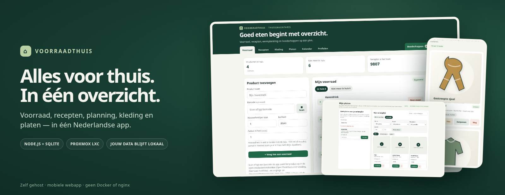</p>
<p align="center"><a href="docs/img/voorraadthuis-rondleiding.mp4">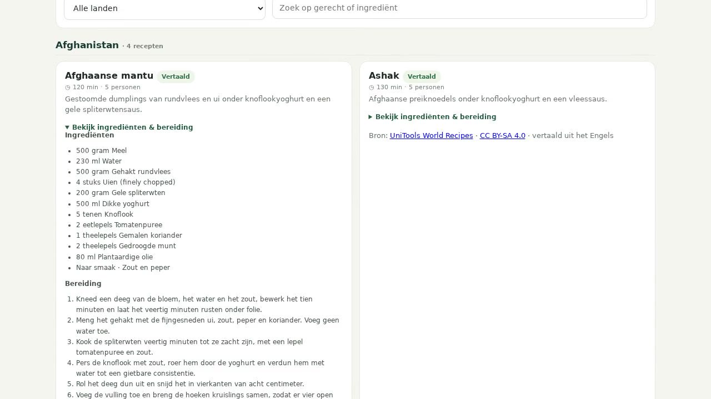</a></p>
<p align="center"><sub>Klik op de poster voor de stille rondleiding (21 sec, 1280×720, zonder audio). Screenshots en video gebruiken een geïsoleerde demodatabase.</sub></p>

VoorraadThuis is een Nederlandstalige thuisapp met zes onderdelen: voorraad, boodschappen, recepten (met de kookpot die je voorraad met 9.807 recepten vergelijkt), kalender en werkrooster, kledingkast (met het weer in het combineeradvies) en lp-verzameling. Alles draait in één Proxmox-LXC als Node.js-service; je gegevens blijven lokaal in SQLite en er zijn geen Docker- of nginx-lagen nodig. De app werkt als mobiele webapp en barcode-scannen gebruikt de ingebouwde HTTPS-dienst.

🎬 **[Stille rondleiding (21 sec · 1280×720 · zonder audio)](docs/img/voorraadthuis-rondleiding.mp4)** — voorraad, recepten, planning, garderobe, boodschappen en de lokale vinylcatalogus.

## Op de telefoon

| Voorraad | Recepten | Kleding | Kalender |
| --- | --- | --- | --- |
| 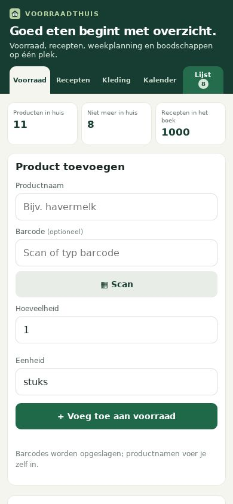 | 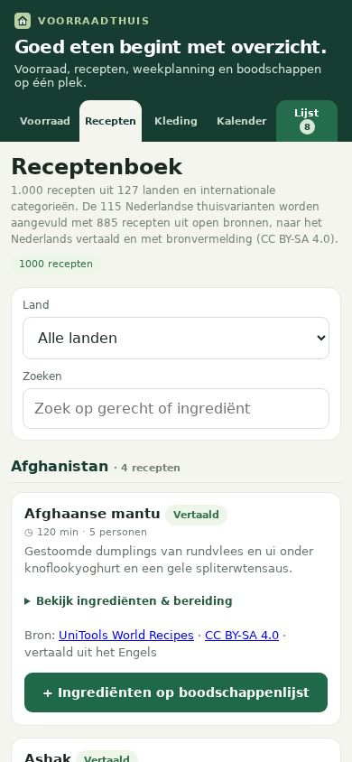 | 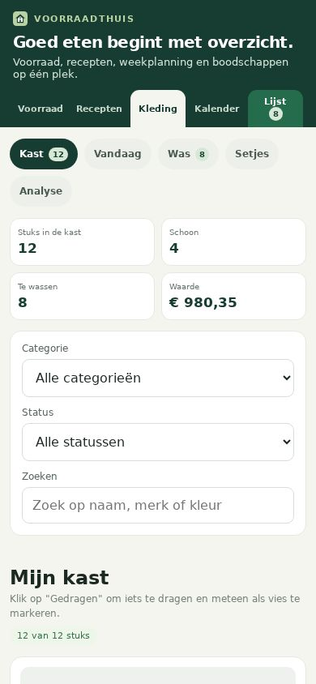 | 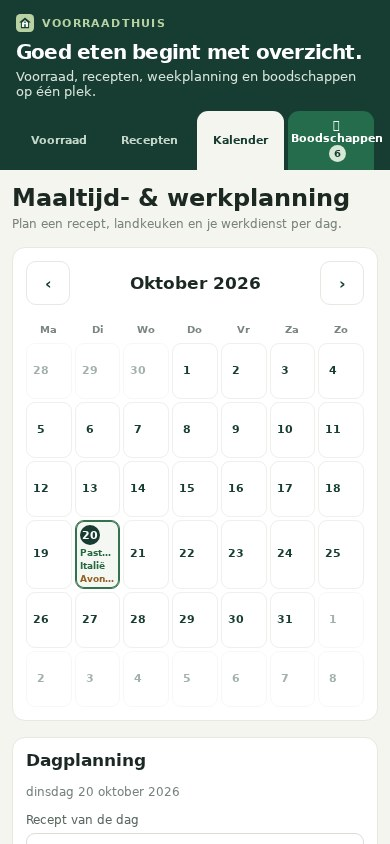 |

| Combineeradvies | Was | Analyse | Boodschappen |
| --- | --- | --- | --- |
| 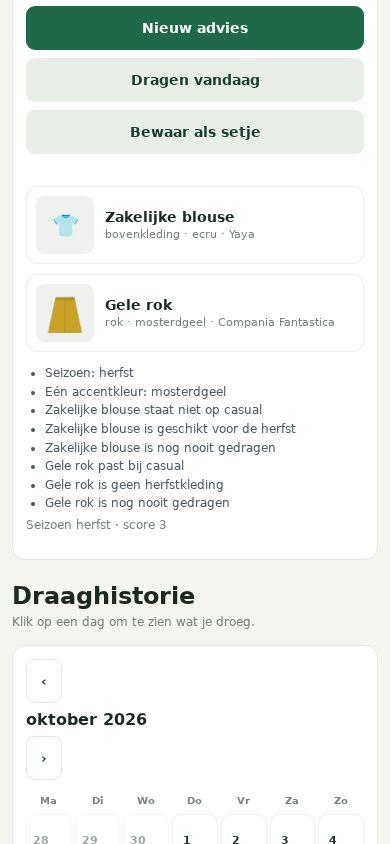 | 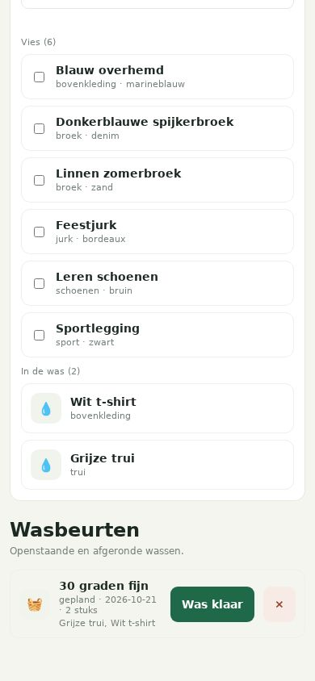 | 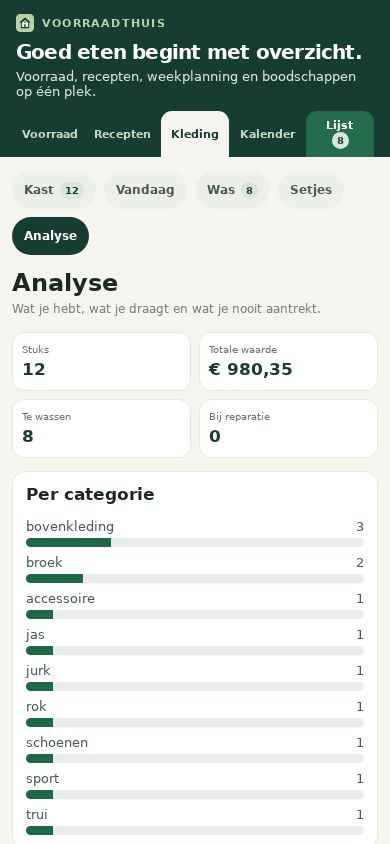 | 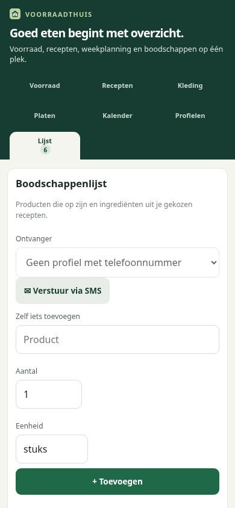 |

- Zes hoofdonderdelen in de navigatie, ook bruikbaar op smalle telefoonschermen.
- Invoervelden op 16 px, zodat iOS niet inzoomt bij het typen; knoppen en velden zijn minimaal 44 px hoog.
- Recepten komen in delen van 48 van de server, met **Nog … recepten laden**; zoeken en filteren gebeurt op de server en ingrediënten worden pas bij het openklappen opgehaald, zodat de pagina ook met 9.807 recepten vlot blijft.
- Veilige marges voor toestellen met een inkeping (`viewport-fit=cover` en `env(safe-area-inset-bottom)`).

### Camera: https in plaats van http

Browsers geven de camera alleen vrij op een **beveiligde verbinding** (https of localhost).
Op een gewoon `http://192.168.1.81`-adres kan de app dus geen barcode scannen — op elke
telefoon, niet alleen op een Samsung. Daarom maakt de installatie een **zelfondertekend
certificaat** aan en luistert de app naast poort 80 ook op **poort 443**:

- Open op de telefoon **`https://192.168.1.81/`** en accepteer eenmalig de waarschuwing
  (*Geavanceerd* → *Doorgaan*). De pagina is dan een beveiligde context: de camera werkt,
  en de webapp kan zichzelf ook installeren en offline werken.
- De waarschuwing helemaal weg? Installeer het certificaat op de telefoon:
  open **`http://192.168.1.81/certificaat.crt`** en kies *Installeren* →
  *CA-certificaat* (Android: *Instellingen → Beveiliging → Versleuteling en inloggegevens →
  Certificaat installeren → CA-certificaat*).
- Zonder https blijft alles werken: typ dan de barcode gewoon in het veld, dan wordt hij
  net zo goed herkend. De app zegt dat er ook bij als je op **Scan** tikt.

Het certificaat staat in `/etc/voorraadthuis/tls/` (tien jaar geldig, met het IP-adres van
de container erin). Is het er niet, dan start de app alleen http — je verliest dan niets
behalve de camera op de telefoon.

### Installeren als app (PWA)

Open de app via `https://<LXC-IP>/`, accepteer eenmalig de waarschuwing van het zelfondertekende certificaat en kies **Toevoegen aan startscherm** (iOS/Safari) of **App installeren** (Android/Chrome). De app opent dan zonder adresbalk en houdt de laatst geladen pagina bij tot de server bereikbaar is. Op `http://<LXC-IP>/` blijven de app en handmatige barcode-invoer werken, maar de camera is alleen beschikbaar via HTTPS. De LXC-app serveert HTTPS zelf op poort 443; er is geen omgekeerde proxy nodig.

<details>
<summary>Schermafbeeldingen op desktop</summary>

| Voorraad | Recepten | Kleding | Combineeradvies |
| --- | --- | --- | --- |
| 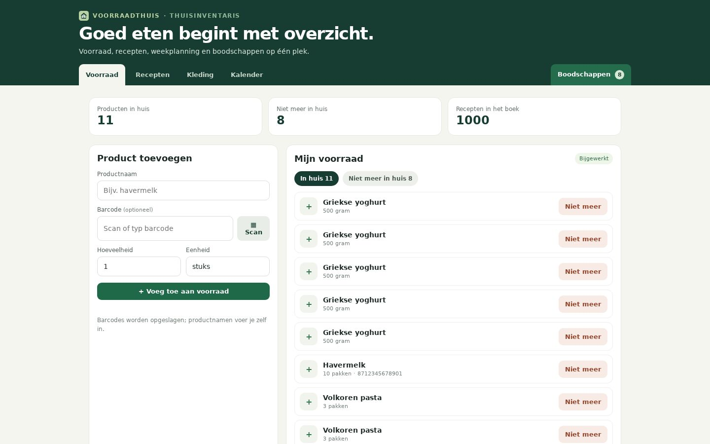 | 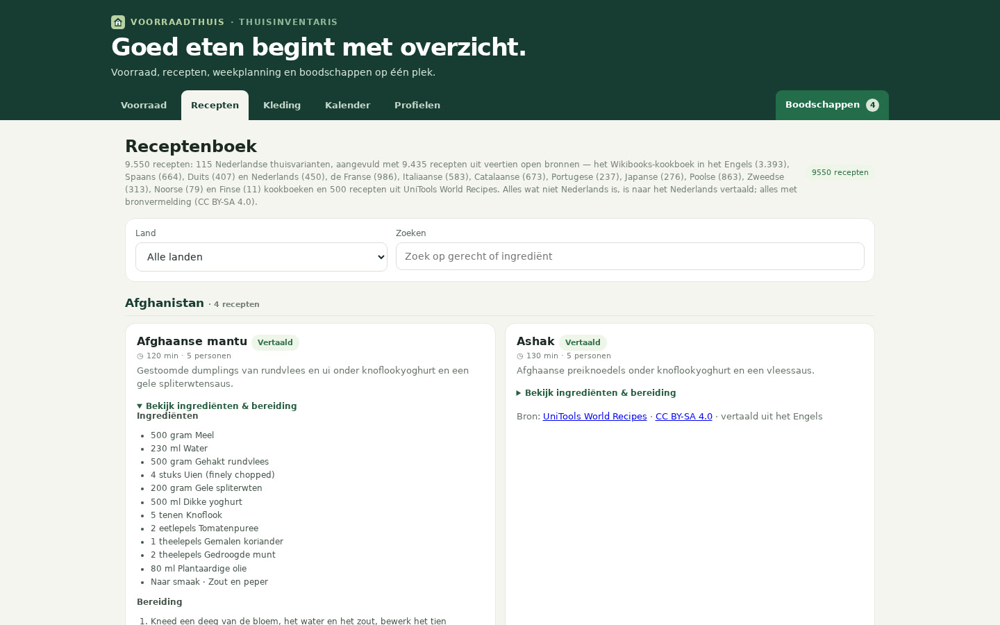 | 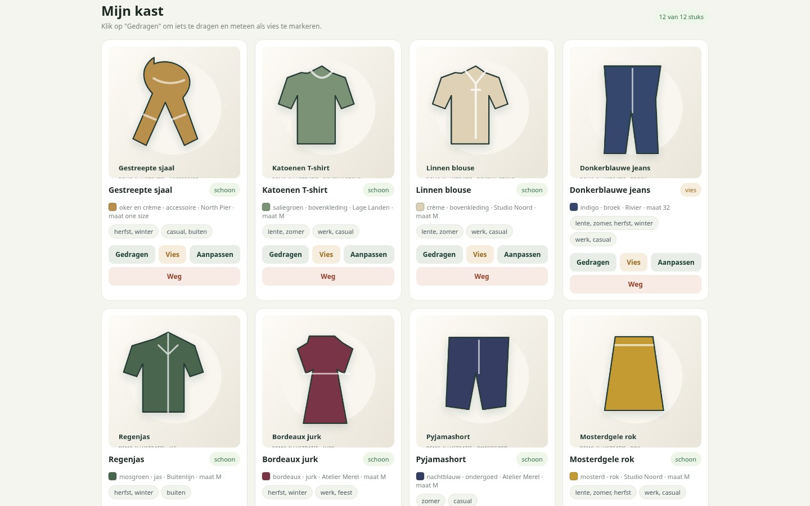 | 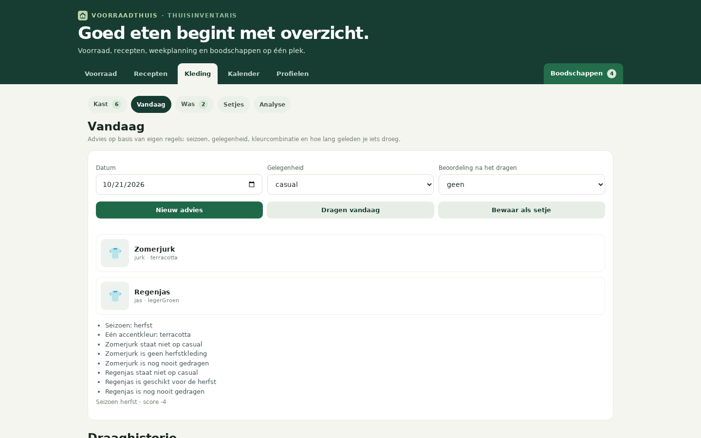 |

| Boodschappen | Kalender | Was | Analyse |
| --- | --- | --- | --- |
| 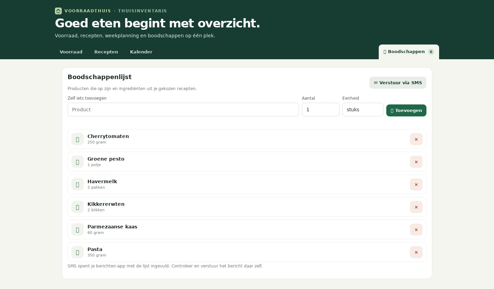 | 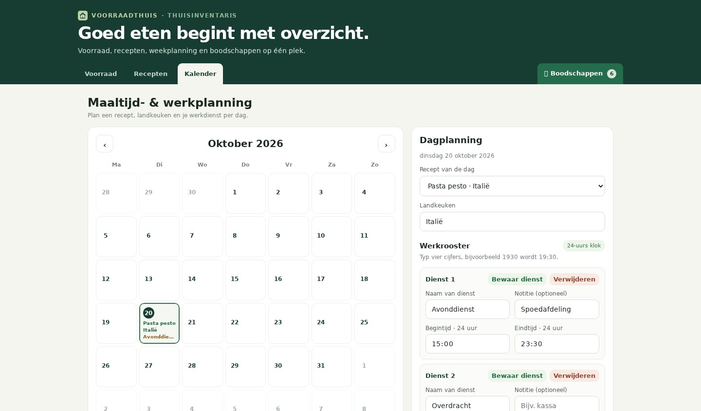 | 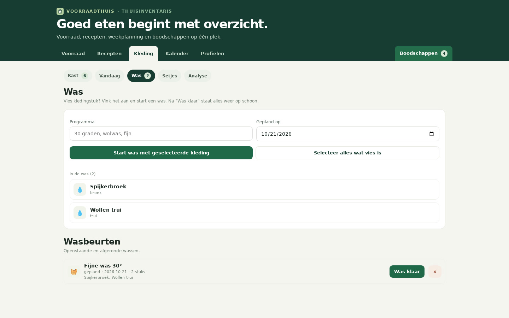 | 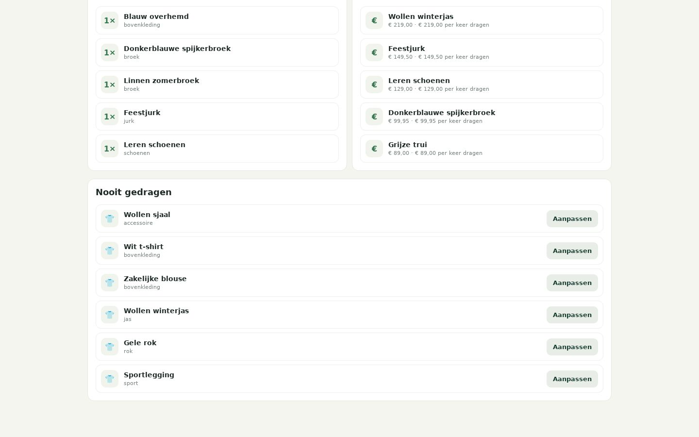 |

</details>

## Wat de app doet

Alles in één app: **voorraad en boodschappen**, **receptenboek met kookpot**, **maaltijd- & werkplanning**, **kledingkast met weer**, **platen** en **profielen**. Alles Nederlandstalig, alles in één SQLite-database naast de app, en zonder account of abonnement.

### Voorraad en boodschappen

| Barcode op de telefoon | Product toevoegen | Barcode op desktop |
| --- | --- | --- |
| 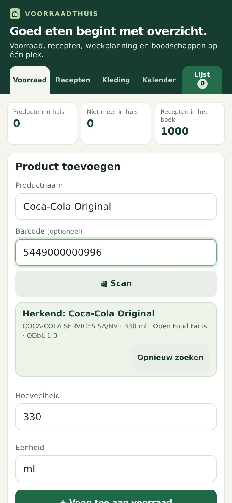 |  | 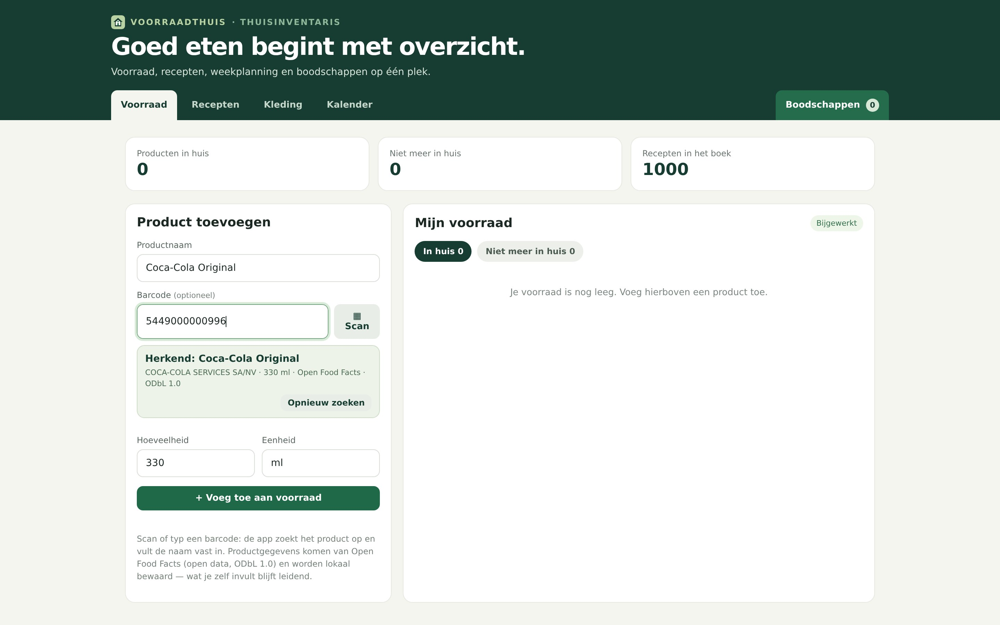 |

**Aantal stuks per product** — vul in hoeveel stuks je in huis hebt en stel het later bij met **−** en **+**:

| Op desktop | Op de telefoon |
| --- | --- |
| 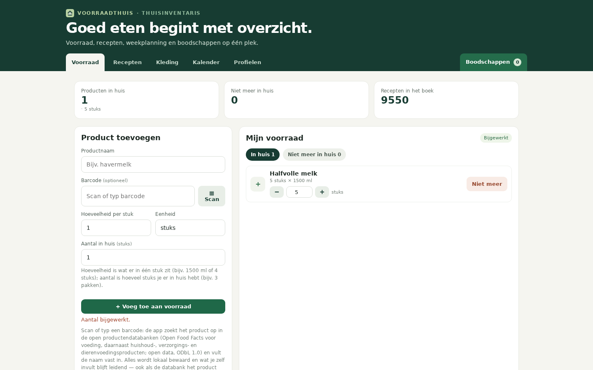 | 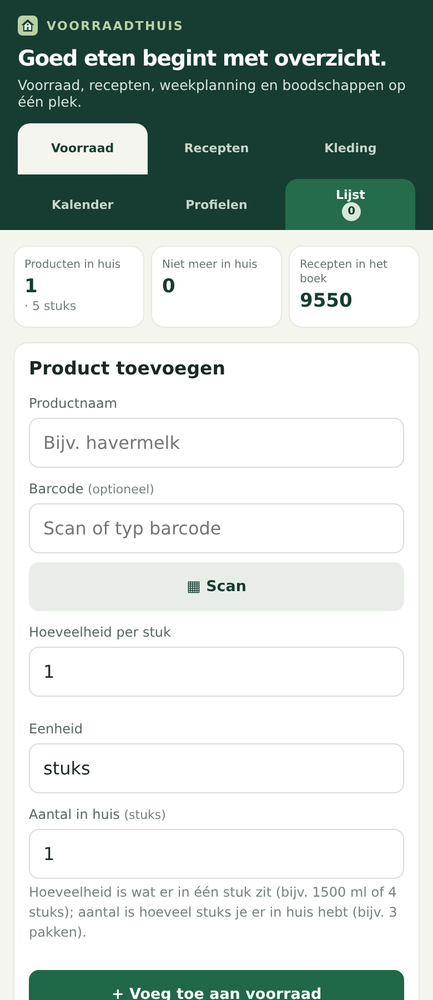 |

- Twee lijsten: **In huis** en **Niet meer in huis**.
- Product handmatig invoeren met naam, hoeveelheid per stuk, eenheid, **aantal in huis** en optionele barcode.
- **Aantal stuks per product**: elk product heeft naast de inhoud van één stuk (bijv. 1500 ml) een aantal — hoeveel stuks je ervan hebt. Bijstellen kan met **−** en **+** of door het getal direct te typen; op nul gaat het product naar de boodschappenlijst. De statistiekkaart telt de stuks mee.
- Barcode scannen met de camera (browser `BarcodeDetector`, vereist camera-toestemming en een beveiligde context) of handmatig invoeren. De scanner vraagt om scherp beeld (tot 1920×1080 en continue autofocus als het toestel die ondersteunt), accepteert pas één retailcode na drie gelijke lezingen met een geldig controlecijfer en zet UPC-E om naar UPC-A. Verkeerd gelezen, ongeldige of tegelijk zichtbare verschillende codes worden niet automatisch ingevuld.
- **Barcodeherkenning**: zodra er een volledige code staat (gescand of getypt) zoekt de app het product op en vult naam, hoeveelheid en eenheid vast in — bijvoorbeeld `5449000000996` → *Coca-Cola Original · 330 ml*. Wat je zelf invult blijft leidend.
- De opzoeking gaat langs vier open databanken: **Open Food Facts** (voeding), **Open Products Facts** (huishoud- en schoonmaakproducten), **Open Beauty Facts** (verzorging) en **Open Pet Food Facts** (dierenvoeding). Zo worden ook Nederlandse schoonmaak- en verzorgingsproducten herkend die in de voedingsdatabank niet staan.
- **Nederlands eerst**: de app vraagt de databanken om Nederlandse gegevens (`lc=nl` en de `product_name_nl`-velden) en kiest de Nederlandse naam als die er is. Heeft de databank alleen een buitenlandse naam, dan staat erbij in welke taal die is, zodat je weet waarom de naam afwijkt.
- **Opnieuw proberen bij drukte**: de databanken geven bij veel verkeer status `429` of `503`. De app probeert het dan nog twee keer met korte tussenpozen, en zegt het pas als het echt niet lukt.
- **Boodschappen van een hele week in één keer.** Met **+ Week erbij** op de boodschappenlijst kies je twee datums; de app zoekt alle geplande recepten in die periode op, telt de hoeveelheden van hetzelfde product bij elkaar op (400 gram tomaten op maandag plus 250 gram op donderdag wordt 650 gram) en zet het resultaat als één regel per product op je lijst. Grote hoeveelheden worden leesbaar: 1500 ml wordt 1,5 liter. Wat per stuk gaat blijft per stuk, en de app vertelt vooraf hoeveel maaltijden en recepten er in die dagen staan.
- **Afvinken in de winkel werkt door in je voorraad.** Vink je een regel af, dan gaat het product van de lijst en in je voorraad; één stuks erbij, of zoveel stuks als er op de lijst stonden (*Eieren · 3 stuks* wordt 3 eieren erbij). De app zegt wat het geworden is, bijvoorbeeld *Ui staat nu 3× in je voorraad.*

| De boodschappen van een week | Afvinken in de winkel |
| --- | --- |
| 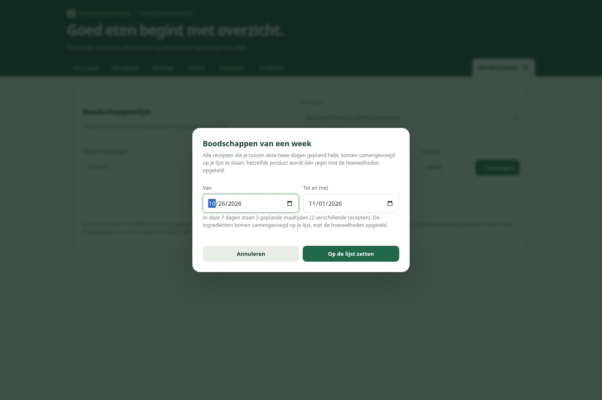 | 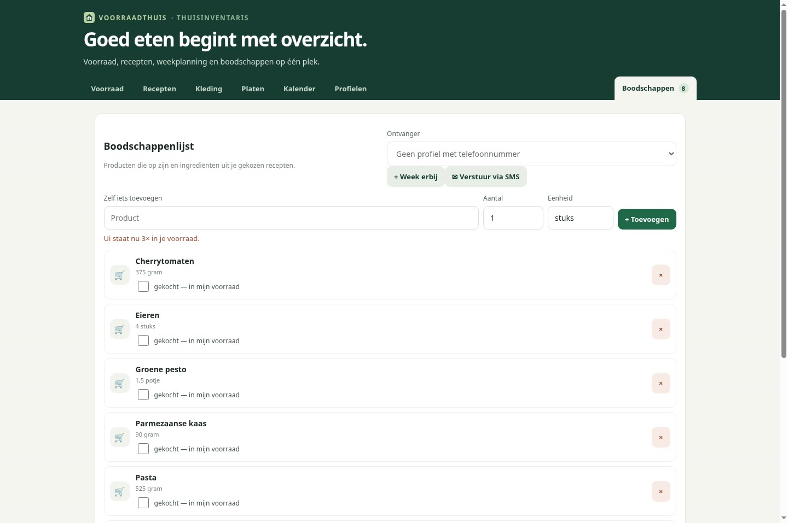 |
| Kies twee datums; de app telt de ingrediënten van alle geplande recepten op. | Afvinken haalt de regel van de lijst en zet het product in je voorraad. |

- **Aantal stuks per product.** Elk product heeft naast de inhoud van één stuk (bijv. 1500 ml) ook een aantal: hoeveel stuks je ervan in huis hebt. Dat vul je in bij het toevoegen en stel je in de voorraadlijst bij met **−** en **+** of door het getal direct te typen. De statistiekkaart telt de stuks mee, en zet je het laatste stuk eraf, dan gaat het product naar de boodschappenlijst. De inhoud van één stuk en het aantal blijven zo twee losse dingen: drie pakken melk van 1500 ml is *3 stuks × 1500 ml*.
- **Huismerken van Nederlandse, Duitse en Belgische supermarkten** staan in een eigen tabel in de app: **45.623 producten van veertig ketens** — Lidl 10.259, REWE 5.286, Kaufland 3.901, Edeka 3.105, Delhaize 2.925, Aldi 2.820, Albert Heijn 2.469, Penny 2.444, Boni 1.100, Carrefour 1.086, Netto 1.056, Jumbo 990, PLUS 977, Colruyt 938, Globus 897, Dennree 769, dm 749, tegut 649, Alnatura 634, Rossmann 595, Norma 358, Cora 238, real 235, Vomar 229, Spar 195, Hoogvliet 166, Dirk 129, HIT 72, DekaMarkt 70, Poiesz 52, Match 51, Aldi Süd 38, Intermarché 36, Famila 34, Marktkauf 26, nahkauf 18, Aldi Nord 13, Okay 12, Jan Linders en MCD. Naar land: **Duitsland 20.521, Nederland 17.347, België 7.755**. Naast de producten staan er **289 barcode-reeksen** in de tabel, waarmee een nog onbekend huismerk toch aan de juiste winkel wordt toegeschreven. Een scan van een huismerk wordt daardoor meteen herkend — zonder opzoeking, zonder wachttijd en ook zonder internet. De tabel kent zowel gewone EAN-13 als de korte EAN-8-codes die supermarkten voor kleine artikelen gebruiken, en bewaart per product de taal van de naam: is die niet Nederlands, dan zegt de app dat erbij.
| Huismerk van Lidl herkend | Huismerk van Aldi herkend |
| --- | --- |
| 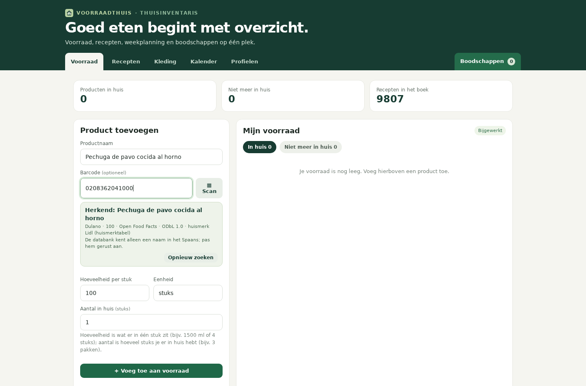 | 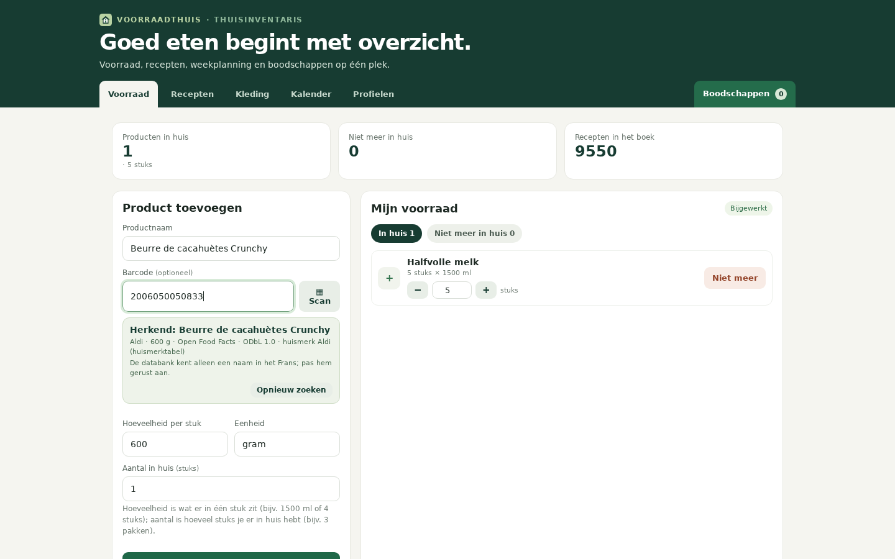 |
| Huismerk van REWE herkend | Huismerk van Delhaize herkend |
|  | 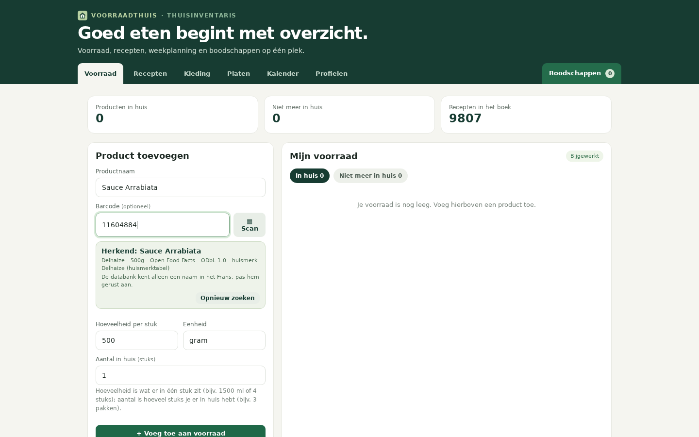 |

- **289 barcode-reeksen** zijn herleid tot de keten die erbij hoort (bijvoorbeeld `8710400…` → Albert Heijn, `8718452…` → Jumbo, `2006050…` → Aldi). Daarmee krijgt een huismerk dat nog niet in de tabel staat tóch een winkelsuggestie.
- De tabel staat in [`product-data/`](product-data/README.md) en is met `python3 scripts/fetch-huismerken.py` opnieuw op te bouwen (Open Food Facts, ODbL 1.0, met naamsvermelding).
- **Onbekend huismerk?** Aan de barcode-reeks is te zien bij welke winkel het hoort (elke keten heeft eigen GS1-prefixen). De app zegt dan bijvoorbeeld *"deze barcode staat nog niet in de open databank, maar hij hoort bij Albert Heijn"* en zet de winkelnemer alvast in het naamveld. Wat je daarna invult, wordt bij die barcode bewaard: de volgende scan is meteen goed.
- Staat een product nergens in, dan zegt de app dat — verse en gloednieuwe producten ontbreken in de open databank. De naam die je zelf invult wordt bij die barcode bewaard, dus een volgende keer is het product meteen bekend.
- De uitkomst wordt lokaal bewaard, dus een tweede scan van hetzelfde product werkt zonder internet; een zelf ingevoerd product wordt bij die code onthouden. Met **Opnieuw zoeken** ververs je de gegevens.
- Een code met een verkeerd controlecijfer wordt gemeld, maar je kunt hem alsnog opzoeken.
- Markeer een product als op: het verhuist naar de afzonderlijke boodschappenlijst-knop.
- Voeg handmatig boodschappen toe of zet ingrediënten van een recept met één druk op de lijst; gelijke ingrediënten worden samengevoegd.
- Herstel of verwijder boodschappen; stuur de lijst per sms naar het nummer van een profiel.

### Receptenboek

- **9.807 recepten**: 115 Nederlandstalige eigen thuisrecepten en **9.692 geïmporteerde recepten uit zestien open bronnen** met CC BY-SA 4.0. Daaronder vallen 257 cocktail- en borrelhapjesrecepten in de categorieën **Cocktails** en **Borrelhapjes**. Je kunt zoeken op gerecht of ingrediënt en filteren op land/categorie; ingrediënten gaan rechtstreeks naar de boodschappenlijst of je plant het gerecht met één knop in de kalender.
- **9.241 geïmporteerde recepten zijn volledig naar het Nederlands vertaald**: naam, omschrijving, ingrediënten en bereidingsstappen. De 451 geïmporteerde recepten die al Nederlands waren (450 uit het Nederlandse Kookboek en één borrelhapje) behouden hun oorspronkelijke tekst. Hoeveelheden, eenheden, tijden, porties, bron-URL en licentie blijven exact zoals de bron ze geeft. De app weigert te starten als een vertaling ontbreekt.
- **Eigen recepten toevoegen.** Met **+ Eigen recept** zet je je eigen gerecht in het boek: naam, landkeuken, aantal porties, bereidingstijd, omschrijving, ingrediënten (één per regel, met de hoeveelheid vooraan: `500 gram spliterwten`), de bereiding per stap, dieetkeuzes, de voedingswaarde per portie en je eigen foto (JPEG, PNG of WebP, maximaal 4 MB). Je eigen recepten staan tussen de andere recepten in, met een badge **Eigen recept**, en doen overal aan mee: zoeken, filteren, de kookpot, porties omrekenen, de kookmodus en de kalender. Later wijzig of verwijder je ze met de knoppen op de kaart.
- **Voedingswaarde per portie.** Vul kcal, eiwit, koolhydraten en vet in en de app toont ze bij het recept. Wat je leeg laat blijft leeg — er wordt niets verzonnen of als nul meegeteld.
- **Dieetfilters.** Filter het receptenboek op **vegetarisch, veganistisch, glutenvrij, lactosevrij of notenvrij**. Eerlijk over de grens: alleen recepten waarvan de dieetkeuze bekend is komen in dat filter voor — dus je eigen recepten. De 9.692 geïmporteerde recepten hebben die gegevens niet en vallen er bewust buiten, in plaats van dat de app er iets van gokt.
- **Snel, ook met 9.807 recepten**: de lijst komt in delen van 48 van de server (gecomprimeerd), zoeken en filteren gebeurt op de server, en ingrediënten en bereiding worden pas opgehaald als je een recept openklapt.
- Alle 9.692 geïmporteerde recepten tonen hun bron en CC BY-SA 4.0-licentie. Dit is een groeiende, niet-uitputtende selectie; zie [`recipe-data/README.md`](recipe-data/README.md) voor bronvermelding, licenties, opdrachten om de data opnieuw op te bouwen en de vertaalvalidatie.
- De 115 eigen thuisvarianten zijn geen volledige inventaris van alle gerechten uit de genoemde landen; traditionele bereidingswijzen kunnen per regio en huishouden verschillen.

| 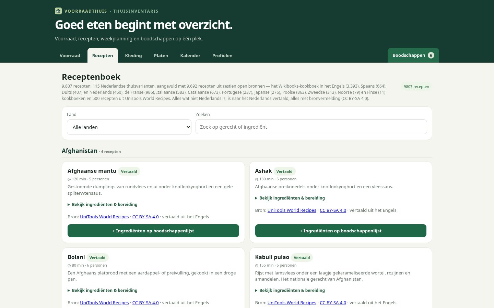 | 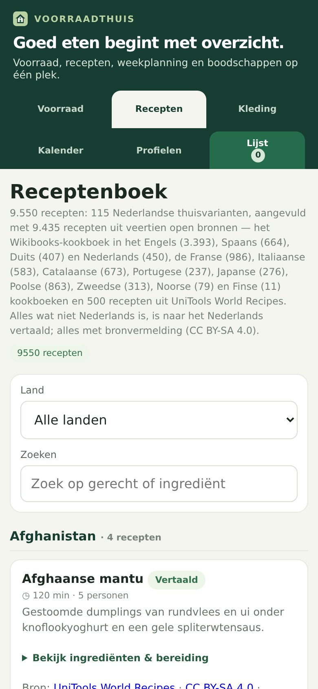 |
| --- | --- |
| Het receptenboek met 9.807 recepten, filters en bronvermelding per recept. | Dezelfde tab op de telefoon; recepten komen per land binnen. |

| Eigen recept in het boek | Formulier voor een eigen recept |
| --- | --- |
| 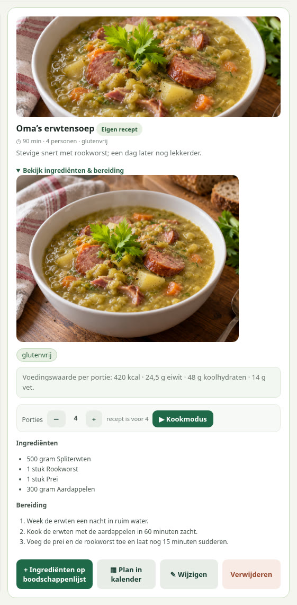 | 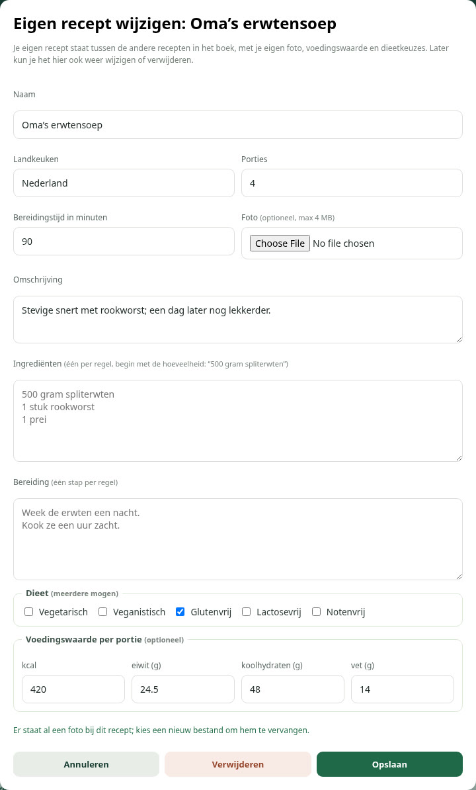 |
| Je eigen recept staat tussen de andere, met badge **Eigen recept**, je foto, de dieetkeuze en de voedingswaarde per portie. | Alles invullen wat je wilt: foto, ingrediënten per regel, bereiding per stap, dieetkeuzes en de voedingswaarde. |

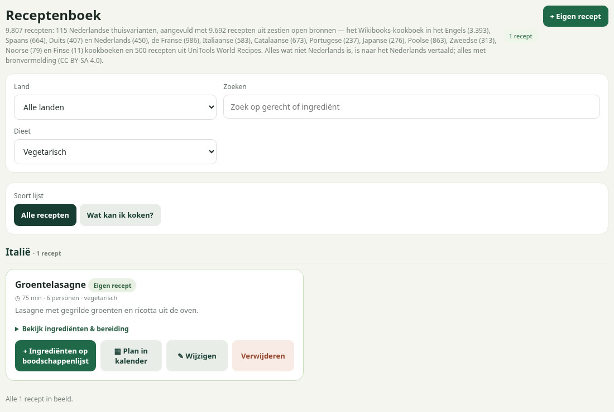

*Het dieetfilter laat alleen recepten zien waarvan de dieetkeuze bekend is.*

**Rondleiding in beeld (23 seconden):** [`docs/img/voorraadthuis-eigen-recepten.mp4`](docs/img/voorraadthuis-eigen-recepten.mp4) — het receptenboek, een eigen recept met foto en dieetkeuze, het invulformulier en het dieetfilter op een rij.

### Kalender en werkrooster

- Maandkalender om per dag een recept en landkeuken te plannen.
- Meerdere benoemde diensten per dag met start- en eindtijd in 24-uursnotatie; `1930` wordt `19:30`.
- **Eigen kleur per dienst**: kies uit acht kleuren (of juist geen). De kleur staat als balkje in de dagcel, als stip in de werkagenda en blijft bewaard bij een opgeslagen dienst (sjabloon). Nieuwe diensten krijgen automatisch een kleur die die dag nog niet gebruikt is.
- **Werkagenda onder de kalender**: elke dag met diensten op een rij, met de naam, de tijden en de notitie, plus het totaal aantal uren van de maand. Een dag aanklikken in de agenda opent die dag in het formulier.
- In de dagcellen staan **alle** diensten met hun tijden (tot drie; daarna `+N`), en de tooltip toont de namen en notities.
- Tijden zonder dubbele punt worden goed gezet: `830` wordt `08:30`, `8` wordt `08:00`. Echt onmogelijke tijden zoals `24:00` blijven een foutmelding.
- Sla diensten op als herbruikbare sjablonen en zet ze met één druk op een gekozen dag. Dagplanning, diensten en sjablonen blijven bewaard in SQLite.

#### Recepten plannen vanuit het receptenboek

Op elke receptkaart staat naast **Ingrediënten op boodschappenlijst** ook **Plan in kalender**. Je hoeft dus geen recept te onthouden of over te typen:

1. Kies in het receptenboek een gerecht en druk op **Plan in kalender**.
2. Kies de dag in het venster; de app zet de gekozen dag eronder voluit bij (*woensdag 28 oktober 2026*) en vertelt of je diensten van die dag blijven staan.
3. Druk op **Plan recept**. De app springt naar de kalender met die dag open.

- Staat er al een ander gerecht op die dag, dan vraagt de app eerst of je het wilt vervangen. Je werkdiensten van die dag blijven altijd staan.
- De landkeuken van het recept wordt meteen meegezet, zodat de dagcel compleet is.
- **Recept plannen** bovenaan de kalender brengt je terug naar het receptenboek.
- Plan je liever vanuit de kalender, dan blijft het oude formulier werken: *Recept van de dag*, *Landkeuken* en **Bewaar dag**. Een gepland recept dat buiten de eerste vijftig zoekresultaten valt, blijft daar netjes geselecteerd staan — **Bewaar dag** wist het dus niet per ongeluk.

| Recepten plannen op desktop | Het venster met de gekozen dag |
| --- | --- |
| 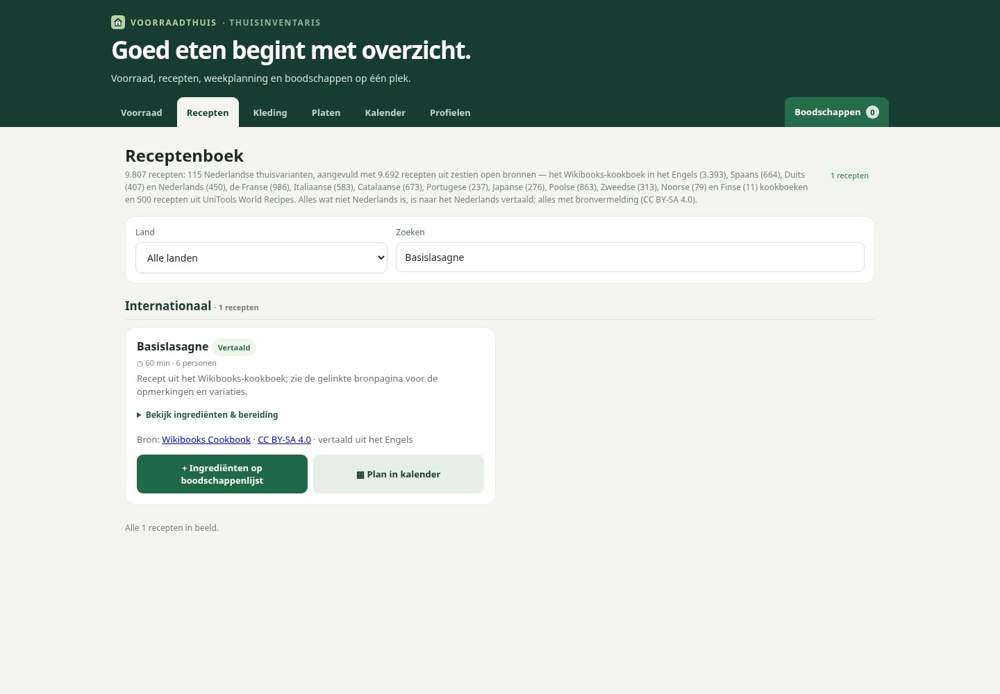 | 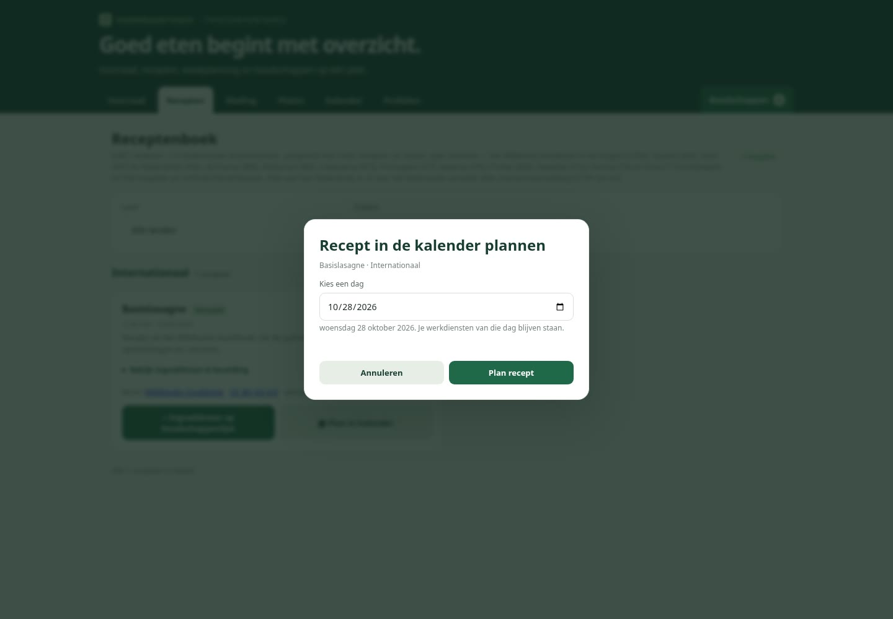 |
| Elke receptkaart heeft naast de boodschappenlijst ook **Plan in kalender**. | De gekozen dag staat er voluit bij, met wat er die dag al staat. |

| Resultaat in de kalender | Op de telefoon |
| --- | --- |
| 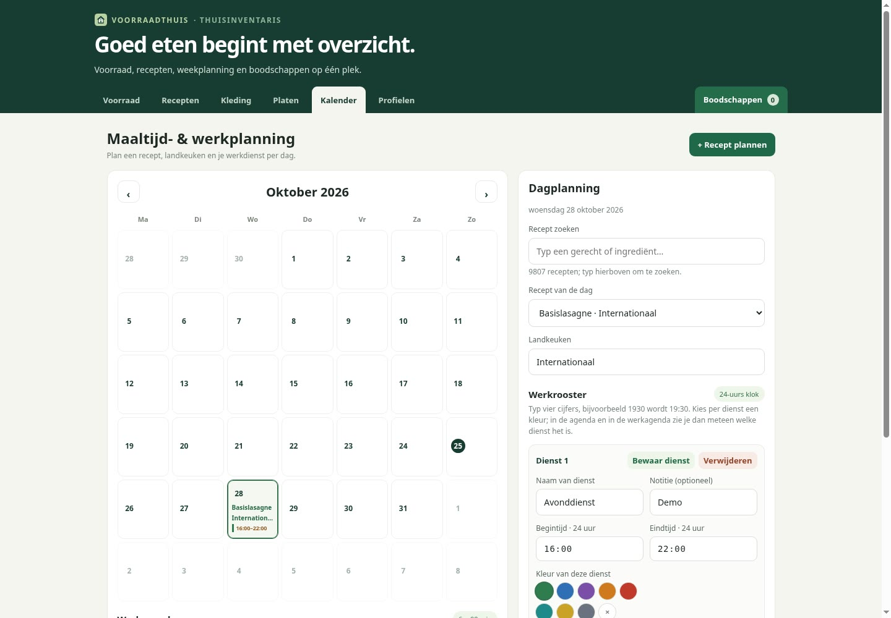 | 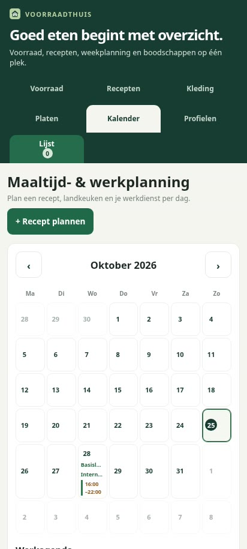 |
| Recept, landkeuken en werkdienst staan samen in de dagcel en in de dagplanning. | Dezelfde route op een smal scherm. |

#### Wat kan ik koken met wat ik in huis heb?

In het receptenboek staat naast **Alle recepten** de knop **Wat kan ik koken?**. De app vergelijkt dan je hele voorraad met alle 9.807 recepten:

- **Nu te maken** staat bovenaan: recepten waarvan alles in huis is.
- Daaronder wat je met één of twee boodschappen kunt maken; met het keuzemenu bepaal je zelf of er 0, 1, 2 of 3 ingrediënten mogen ontbreken.
- Elke kaart zegt wat er nog mist (bijvoorbeeld *Ontbreekt nog: prei, room*) met de knop **+ Ontbrekende op de lijst** die precies die producten op je boodschappenlijst zet — wat al in huis is blijft eraf.
- **Voorraadkast-basis telt mee**: zout, peper, water, olie, suiker, bloem, bakpoeder en azijn hoef je niet in te voeren; de app zegt erbij dat ze als aanwezig gelden.
- Wat je zelf in je voorraad typt blijft leidend. Enkelvoud en meervoud horen bij elkaar (*ei* en *eieren*, *ui* en *uien*), en samengestelde namen matchen op het deel dat je hebt (*cherrytomaten* of *tomatenblokjes* bij *tomaten*). Een écht ander product wordt niet goedgekeurd: met melk in huis wordt *kokosmelk* niet goedgekeurd.

De samenvatting boven de lijst zegt hoeveel recepten er nu te maken zijn en hoeveel er met jouw marge bijkomen; zoeken en filteren op land werken in deze stand hetzelfde.

| Wat kan ik koken | Porties omrekenen |
| --- | --- |
| 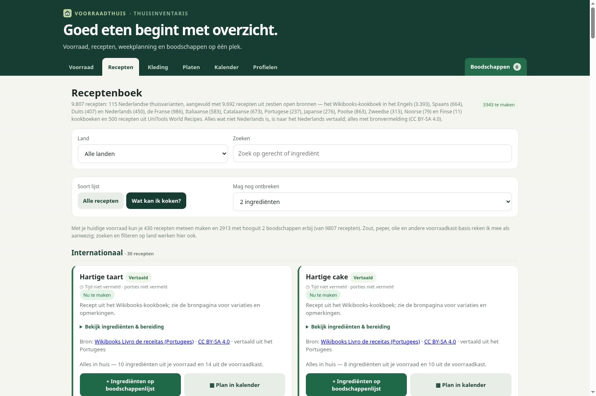 | 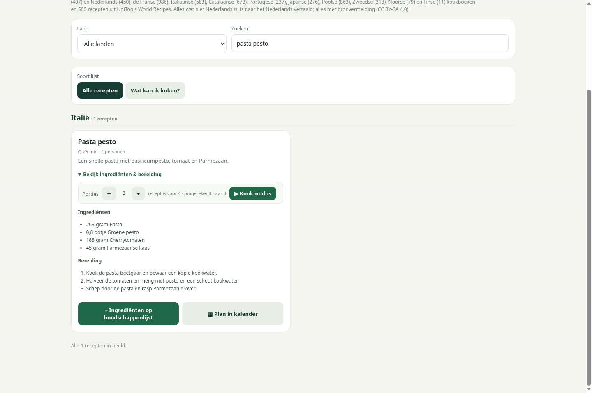 |
| Recepten die je met je voorraad kunt maken, met per kaart wat er nog mist. | Met **−** en **+** zet je de hoeveelheden op het aantal personen dat je nodig hebt. |

#### Porties omrekenen en kookmodus

- **Porties omrekenen**: elk recept met losse hoeveelheden heeft een porties-kiezer. Zet je een recept voor 4 op 3 personen, dan rekenen alle hoeveelheden mee (350 gram pasta wordt 263 gram, 1 potje pesto wordt 0,8). Ingrediënten die je per stuk koopt blijven heel: vier eieren voor drie personen wordt er voor twee personen drie, geen 2,7.
- **Zelfde porties op de boodschappenlijst**: wat je kiest, gaat zo op de lijst. Ook bij **Porties die dag** in de dagplanning; die keuze onthoudt de app per dag en gebruikt hij bij het samenvoegen van een week.
- **Kookmodus**: het hele scherm wordt een kookboek op ooghoogte — grote stappen, de ingrediëntenlijst met de omgerekende hoeveelheden ernaast, en **Vorige**/**Volgende** (of de pijltjes op je toetsenbord). Het scherm blijft aan zolang de kookmodus openstaat.
- **Timer per stap**: noemt een stap een tijd (*laat 15 minuten sudderen*), dan staat er een timer-knop bij. Tik erop en er loopt een aftellende timer met piepje en, als je dat toestaat, een melding op je telefoon.

#### Je planning in je eigen agenda (.ics)

Boven de kalender staan twee knoppen: **📅 Deze maand (.ics)** en **📅 Hele agenda (.ics)**.

- **Diensten** komen er als afspraken met tijd in te staan: de naam, de notitie en de kleur van de dienst gaan mee. Een nachtdienst die over middernacht loopt (22:30–06:15) eindigt netjes de volgende dag.
- **Het geplande recept** staat er als hele-dag-item, met de landkeuken en het aantal porties erbij.
- **Automatisch bijwerken**: abonneer je agenda-app op `http://<adres-van-de-app>/api/agenda.ics` (iPhone: Instellingen → Agenda → Accounts → Agenda-account toevoegen → *Abonneer op agenda*; Android en de computer: agenda toevoegen via een internetadres). Het bestand zegt zelf dat het elk uur ververst mag worden (`REFRESH-INTERVAL` en `X-PUBLISHED-TTL`), dus een wijziging die je hier maakt zie je binnen het uur terug.
- **Een wijziging komt door als nieuwe versie**: elke geplande dag heeft een revisienummer dat alleen maar omhoog gaat en dat als `SEQUENCE` meegaat, met `LAST-MODIFIED` erbij. Zo werkt je agenda hetzelfde item bij in plaats van de oude versie te laten staan of er een dubbele dag van te maken. Het wissen van een dag telt ook mee, dus opnieuw plannen komt altijd hoger uit.
- **De twee knoppen downloaden een momentopname** van dit moment: handig om één keer te importeren, maar zo'n bestand werkt niet vanzelf bij — gebruik daarvoor het abonnement hierboven.
- **Eén richting**: wijzigingen gaan van deze app naar je agenda. Wat je in je agenda-app zelf verzet, komt niet terug in de app; hier plan je.
- **Wat je agenda-app ophaalt, is altijd de actuele stand**: het adres leest de planning op het moment van opvragen. Een agenda-app die niets gewijzigd ziet, krijgt van de app een kort `304`-antwoord met een etiket (ETag) in plaats van het hele bestand.
- Rechtstreeks op te halen: `/api/agenda.ics` voor alles en `/api/agenda.ics?maand=2026-10` voor één maand. Het bestand is een gewone iCalendar-agenda (RFC 5545) met de tijdzone van Nederland erin.

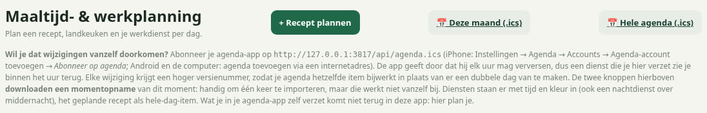

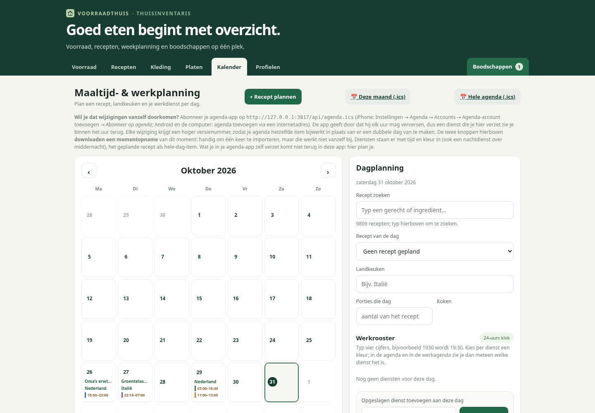

| Kookmodus met timer |
| --- |
| 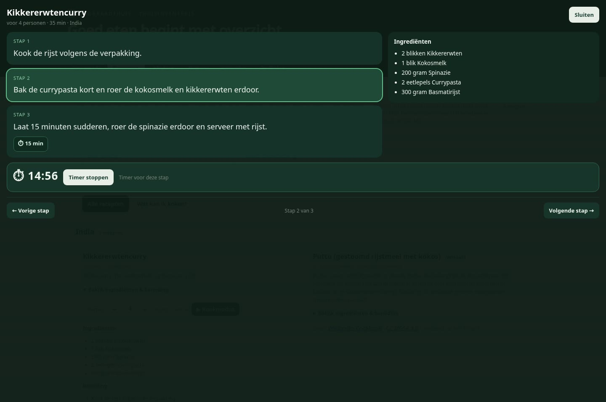 |

🎬 **[Stille rondleiding: koken met je voorraad (21 sec · 1280×720 · zonder audio)](docs/img/voorraadthuis-keuken-rondleiding.mp4)** — kookpot, porties omrekenen, kookmodus met timer, een week samenvoegen, afvinken in de winkel en het weer in het kledingadvies.

🎬 **[Stille rondleiding: een recept plannen (15 sec · 1280×720 · zonder audio)](docs/img/recepten-plannen-rondleiding.mp4)** — van receptkaart tot kalender, met echte schermen uit een geïsoleerde demodatabase.


### Kleding (Kledingkast)

| Kast | Vandaag | Was | Analyse |
| --- | --- | --- | --- |
| 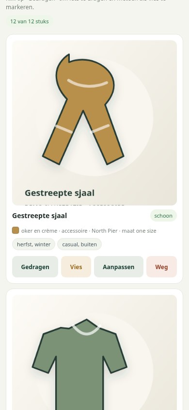 |  |  |  |

| Meerdere kasten op desktop | Meerdere kasten op de telefoon |
| --- | --- |
| 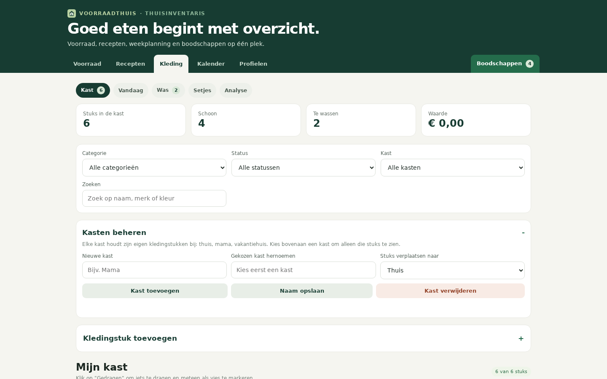 | 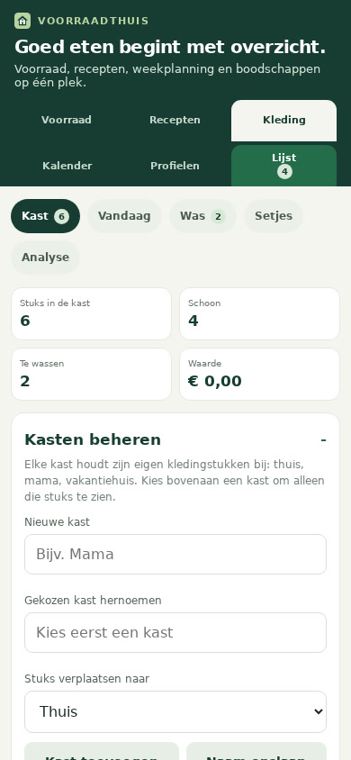 |

- **Meerdere kledingkasten**: naast elkaar bijvoorbeeld *Thuis* en *Mama*. Elk kledingstuk hoort bij één kast; met het kastfilter zie je alleen die kast, en op elke kaart staat bij welke kast het stuk hoort. In **Kasten beheren** maak je een kast, hernoem je hem of verwijder je hem — kleding verhuist dan in één stap naar een andere kast. Bestaande kasten uit een oudere versie komen automatisch in de eerste kast (*Thuis*) terecht.
- Kledingstukken met naam, categorie, kleur (met kleurcode), patroon, maat, merk, materiaal, seizoenen, gelegenheden, prijs, notities en een foto. Filter op categorie, status of kast en zoek op naam, merk, kleur of notitie.
- Status per stuk: **schoon**, **vies**, **in de was** of **reparatie**, met tellers in de navigatie.
- **Vandaag** geeft een combineeradvies voor de gekozen dag en gelegenheid, met de beweegredenen erbij. Met één knop registreer je het als gedragen (het stuk gaat dan op vies) of bewaar je het als setje.
- **Was**: vies kleding bij elkaar vinken, een was starten met programma en datum, en met **Was klaar** staat alles weer op schoon. Een was annuleren zet de kleding terug op vies.
- **Setjes**: vaste combinaties bewaren en in één tik opnieuw dragen; ze verschijnen ook in de draaghistorie.
- **Analyse**: aantal per categorie, kleurverdeling, meest en nooit gedragen, te wassen, prijs per keer dragen en de totale waarde van je kast. Daarnaast een maandkalender met wat je per dag droeg.
- Foto's maak je met de camera-knop in het formulier of kies je uit je album; ze worden opgeslagen in een aparte fotomap.

#### Het weer in het advies

Vul onder het advies een plaats in (bijvoorbeeld *Delft*) en druk op **Zoek en bewaar**: de app haalt de verwachting van vandaag op bij [Open-Meteo](https://open-meteo.com/) — een openbare dienst zonder sleutel en zonder account — en laat die meewegen:

- **Regen** (50% of meer): het advies kiest waterdichte schoenen en laat leer en suède staan, met de regel erbij waarom.
- **Koud** (5 °C of minder) of **fris** (tot 12 °C): een warme jas en een extra laag; ook bij het sporten gaat er dan een jas mee.
- **Warm** (22 °C of meer): lichte kleding en de jas blijft thuis.
- **Hardewind** (40 km/u of meer): een winddichte jas.

De verwachting wordt in je eigen database bewaard (drie uur geldig), dus het advies haalt niet bij elk verzoek opnieuw op. Zonder internet, zonder plaats of met het weer uitgevinkt blijft het advies gewoon werken op seizoen en gelegenheid — er staat dan alleen geen weerregel bij.

| Weer in het kledingadvies |
| --- |
| 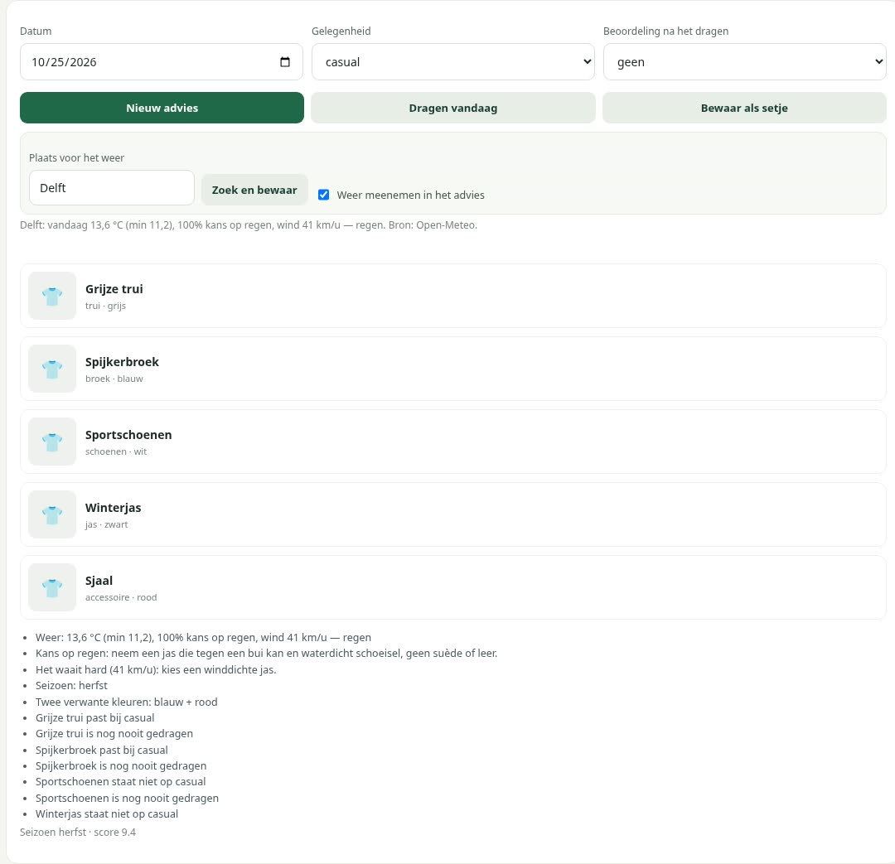 |

#### Hoe het combineeradvies werkt

Het advies komt uit eigen, uitlegbare regels — geen taalmodel en geen internetverbinding nodig:

1. Alleen kledingstukken met status **schoon** komen in aanmerking.
2. Per gelegenheid hoort een vaste opbouw: werk vraagt bijvoorbeeld om bovenkleding of een jurk met een broek of rok, schoenen en in het koude seizoen een jas.
3. Seizoenen en gelegenheden die je per stuk hebt aangegeven wegen mee; kleding die daar niet bij past valt af.
4. Kleurharmonie: rustige basiskleuren mogen overal bij, één accentkleur is prima, twee verwante tinten mogen, twee felle kleuren krijgen straf.
5. Wat je de laatste drie dagen droeg krijgt straf, zodat je niet steeds hetzelfde advies krijgt; zelden gedragen kleding krijgt een kleine voorkeur.

Elke uitkomst toont de gebruikte argumenten. Met **Nieuw advies** vraag je een volgende goede combinatie op.

#### AI-tagging (optioneel, standaard uit)

Met een OpenAI-compatibele dienst (OpenAI, Ollama, LocalAI) kan de app een kledingfoto zelf lezen en naam, categorie, kleur, patroon, materiaal en seizoen invullen. Zet daarvoor `AI_BASE_URL`, `AI_API_KEY` en `AI_VISION_MODEL`; zonder die instellingen blijft de knop om een foto te lezen verborgen en werkt de app volledig handmatig. Wat je zelf invult is altijd leidend.

*Barcodeherkenning*: `GET /api/barcode/<code>` (met `?force=1` om bestaande gegevens te verversen). Zonder internet (`BARCODE_OFFLINE=1`) gebruikt de app alleen wat al bekend is; met `BARCODE_DATABANKEN` wijs je eigen databanken aan (kommagescheiden, bijvoorbeeld `Open Food Facts=https://mijn.databank,Open Products Facts=https://…`); `BARCODE_API` zet één adres en blijft werken zoals het was.

> Productgegevens komen van [Open Food Facts](https://world.openfoodfacts.org/), beschikbaar onder de [Open Database License (ODbL) 1.0](https://opendatacommons.org/licenses/odbl/1-0/). Camera-scannen werkt in browsers die `BarcodeDetector` ondersteunen (Chrome op Android, Edge) en doorgaans alleen via HTTPS; op iOS typ je de code — die wordt ook meteen herkend.

### Platen (lp-verzameling)

Onder **Platen** houd je je eigen lp-verzameling bij. De barcode-opzoeking controleert eerst de lokale MusicBrainz-lijst; daarna kan hij de aparte, alleen-lezen Discogs-catalogus raadplegen. MusicBrainz-hoezen worden bij het [Cover Art Archive](https://coverartarchive.org/) opgehaald en één keer lokaal bewaard. Discogs-hoesafbeeldingen worden niet gebruikt.

Ontbreekt de hoes van een plaat die al in je verzameling staat, dan haalt de app die op de achtergrond alsnog op. Eerst via de eigen lp-lijst (één verzoek aan het Cover Art Archive), daarna door de barcode online op te zoeken, en pas als dat niets oplevert via **titel en artiest**. Dat werkt ook voor platen zonder barcode. De app kijkt daarbij alle persingen van die plaat na — het archief heeft er vaak maar bij één een hoes — en probeert het bij een verkeerd gespelde of afgekorte artiestennaam nog eens met de titel alleen. Alleen een uitgave met dezelfde titel (een ondertitel vóór of na een dubbele punt mag verschillen; "Deel 2" niet) én dezelfde artiest telt, zodat er nooit een hoes van een andere plaat op je verzameling komt. Dit gebeurt rustig, één plaat per keer; een plaat waar niets te vinden was krijgt na een dag opnieuw een kans, en een storing bij de databank telt niet mee, zodat een mislukte poging gewoon opnieuw gebeurt.

- **Lokale vinylcatalogus.** De MusicBrainz-tabel bevat 101.982 barcoderegels. De Discogs-releaseasset bevat 1.023.483 geldige barcode/release-ID-koppelingen en **799.740 unieke geldige vinylbarcodes**, waaronder 708.077 codes die niet in de lokale MusicBrainz-lijst voorkomen. Placeholdercodes met alleen herhaalde cijfers zijn geweerd. Eén barcode kan bij meerdere persingen horen; de catalogus bewaart elke combinatie van barcode en release-ID.
- **Collectie en catalogus blijven gescheiden.** Zoekresultaten vullen gegevens in, maar worden nooit automatisch in je persoonlijke verzameling gezet. Je kiest zelf of je een uitgave aan je collectie of verlanglijst toevoegt.
- **Verlanglijst met richtprijzen.** Zoek in de lokale MusicBrainz- en Discogs-catalogus, voeg een gevonden uitgave expliciet toe en noteer optioneel een richtprijs. Het gemiddelde gebruikt alleen regels met een ingevulde prijs.
- **Bronvermelding.** Discogs-resultaten tonen de bron en linken naar de releasepagina. De data is metadata-only; er staan geen Discogs-afbeeldingen of gebruikers-/marketplacegegevens in de asset. Zie [`product-data/README.md`](product-data/README.md) voor de dumpdatum, CC0-licentie, aantallen en controleprocedure.
- **Overzicht met alles erop.** Elke plaat staat als kaart met de hoes, artiest, jaar, formaat, label, eventuele notitie en het aantal exemplaren. Zonder bekende hoes krijg je een nette kaart met de beginletter.
- **Meerdere locaties, helemaal zelf te kiezen.** Je typt de plek zelf in (*Kast in de gang*, *Zolder*, *bij mama*) — er staat geen standaardplek in het veld en de app stelt alleen de plekken voor die je zelf al gebruikt. Dezelfde plek bij een tweede plaat verschijnt vanzelf als tab, en met het keuzemenu onder een plaat verhuist hij naar een bestaande of gloednieuwe plek. Boven de verzameling staan tabs met het aantal per plek.
- **Filteren op genre, artiest, locatie en jaartal.** Boven de verzameling staan keuzelijsten met aantallen erbij: elk genre, elke artiest en elk decennium dat in je kast voorkomt — plus *jaartal onbekend* en *genre onbekend* om juist de platen zonder gegevens op te sporen. Daarnaast kun je met *van* en *tot* op een periode filteren. Alles werkt tegelijk en naast het zoekveld en de locatietabs; boven de lijst staat wat er gefilterd is met één knop om alles weer los te laten.
- **Echte genres, geen uitgiftetype.** Het genre komt uit de uitgave-groep in MusicBrainz (rock, jazz, soul, electronic), niet uit het soort uitgave; is daar niets bekend, dan valt de app terug op *Album*, *Single* enzovoort.
- **Zoeken en opruimen.** Zoek op titel, artiest, jaar of label, en haal een plaat met één knop uit de verzameling. Dezelfde plaat op dezelfde plek telt op in plaats van dubbel te verschijnen.
- **Niemand hoeft dit te leren.** De app onthoudt wat je zelf invult; wat jij typt blijft leidend boven wat de databank zegt.

| Platen op desktop | Platen op de telefoon |
| --- | --- |
| 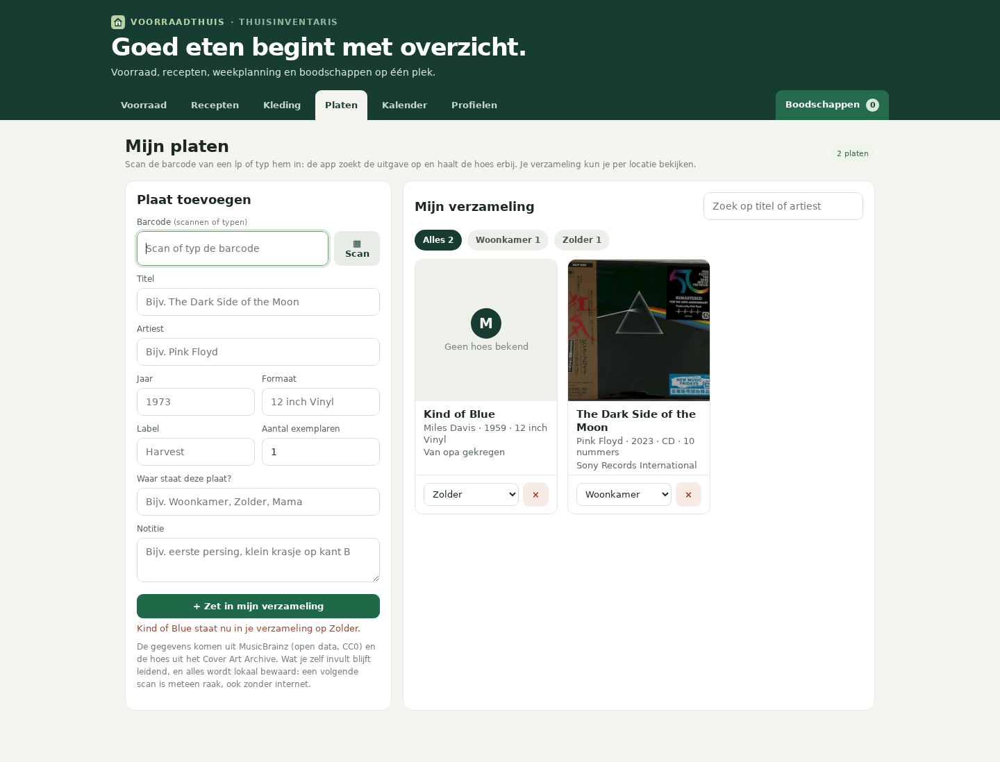 | 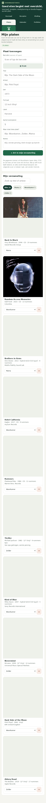 |
| Filteren op genre en decennium | Filters op de telefoon |
| 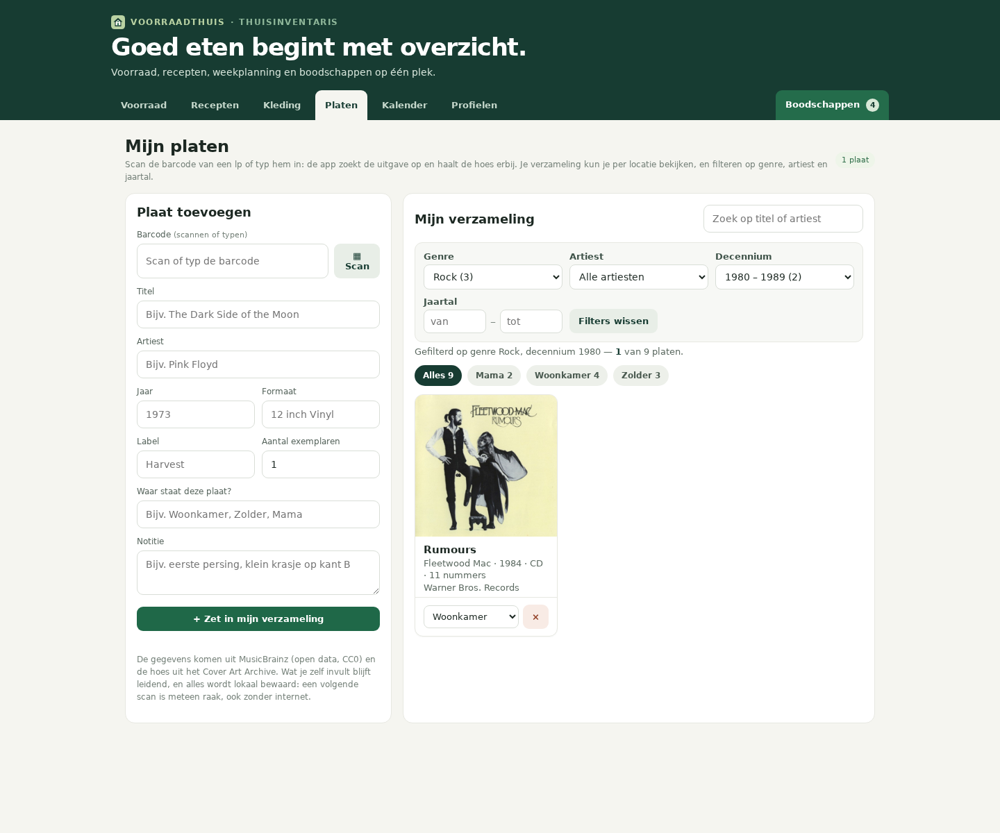 | 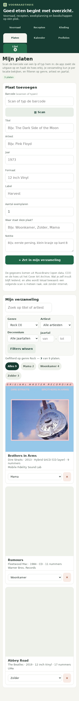 |

| Catalogus zoeken op desktop | Catalogus zoeken op de telefoon |
| --- | --- |
| 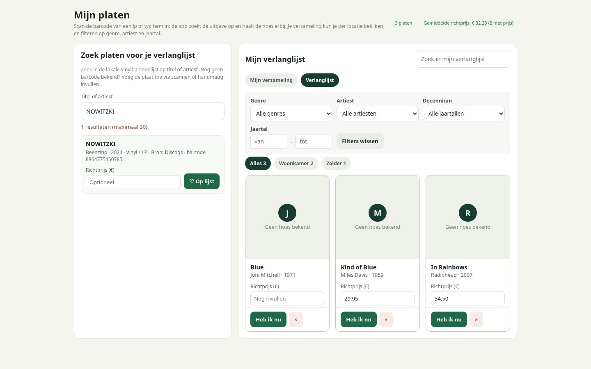 |  |
| Voorbeeldzoekresultaat met bronvermelding; toevoegen aan je lijst blijft een aparte keuze. | Hetzelfde zoekresultaat in de mobiele weergave. |

> **Deze twee onderdelen staan standaard verborgen:** de waarde in de kop, de printbare inventaris en de CSV staan niet in de app. De verzameling zelf, de gegevens en de routes blijven gewoon werken. Zo zet je ze aan: `Environment=PLATEN_WAARDE_ZICHTBAAR=1` in `/etc/systemd/system/voorraadthuis.service`, daarna `systemctl daemon-reload && systemctl restart voorraadthuis`. Weer verbergen: die regel weghalen en opnieuw laden.

- **Wat is de verzameling waard?** Boven de verzameling staat de totale waarde op basis van de prijzen die je zelf invult (prijs × aantal exemplaren). De verlanglijst telt niet mee, en wat nog geen prijs heeft wordt apart gemeld in plaats van als nul geteld; per plek zie je wat daar staat en wat het waard is.
- **Inventaris voor de verzekering.** Met **🖨 Inventaris (print of PDF)** opent een overzichtelijke pagina met alle platen op één regel: titel, artiest, jaar, label, formaat, locatie, aantal, prijs per stuk, totaal en notitie, met het totaal eronder. Afdrukken of bewaren als PDF gaat met de knop of Ctrl/Cmd + P. **CSV voor de verzekering** geeft dezelfde lijst als bestand met puntkomma's als scheiding en bedragen met een komma, bijvoorbeeld om in Excel te openen of aan de verzekeraar te sturen.

| Platen met de waarde en de inventaris uit |
| --- |
|  |
| De verzameling werkt gewoon; de waarde, de printbare inventaris en de CSV staan standaard uit. |

*Barcodeherkenning voor platen*: `GET /api/platen/zoek?code=<barcode>` (met `?force=1` om opnieuw te zoeken). De opzoeking wordt lokaal bewaard, dus de tweede keer is het antwoord direct en werkt het ook zonder internet.

## Proxmox LXC installeren (zoals BeatSync)

VoorraadThuis installeer je op dezelfde manier als BeatSync: voer op de Proxmox-host als root uit:

```bash
bash <(curl -fsSL https://raw.githubusercontent.com/Theberas04/voorraadthuis/main/deploy/proxmox/install.sh)
```

Het script haalt de installerbestanden rechtstreeks van GitHub, maakt een Debian 13 LXC aan en start de app als systemd-service. De app serveert zelf **HTTP op poort 80 en HTTPS op poort 443** met een lokaal aangemaakt zelfondertekend certificaat; er is geen nginx of omgekeerde proxy nodig. `FETCH_ONLY=1` haalt de bestanden op en controleert ze zonder een container te maken.

Standaard gebruikt de LXC `vmbr0` en DHCP. Vast IP kan bijvoorbeeld zo:
```bash
CTID=120 STATIC_IP=192.168.1.50/24 GATEWAY=192.168.1.1 \
  bash <(curl -fsSL https://raw.githubusercontent.com/Theberas04/voorraadthuis/main/deploy/proxmox/install.sh)
```
Na afloop werkt `http://<LXC-IP>/`; gebruik `https://<LXC-IP>/` voor camera-toegang en accepteer de certificaatwaarschuwing één keer. Bijwerken zonder je gegevens te wissen:
```bash
bash <(curl -fsSL https://raw.githubusercontent.com/Theberas04/voorraadthuis/main/deploy/proxmox/update-from-github.sh) 120
```
Vervang `120` door je CTID. De app heeft geen login en is bedoeld voor het vertrouwde LAN; stel hem niet rechtstreeks bloot aan internet.

Nieuwe containers worden op **Debian 13** gemaakt; met `DEBIAN_MAJOR=12` maak je nog een oude versie.

### Een bestaande container naar Debian 13 brengen

Draait je LXC nog op Debian 12, dan zet dit script hem om naar **Debian 13 (trixie)** — de app en je gegevens blijven staan. Voer op de Proxmox-host uit:

```bash
bash <(curl -fsSL -H 'Accept: application/vnd.github.raw' https://api.github.com/repos/Theberas04/voorraadthuis/contents/deploy/proxmox/upgrade-debian-13.sh) 120
```

Wil je eerst alleen kijken wat er zou gebeuren (er wordt dan niets geïnstalleerd of herstart):

```bash
DROOG=1 bash <(curl -fsSL -H 'Accept: application/vnd.github.raw' https://api.github.com/repos/Theberas04/voorraadthuis/contents/deploy/proxmox/upgrade-debian-13.sh) 120
```

Wat het script doet, in deze volgorde:

1. **Momentopname** van de container (`voor-debian13-<datum>`). Zonder momentopname begint het niet — dat is de enige echte terugweg bij een mislukte systeemsprong (`ZONDER_SNAPSHOT=1` is het noodluik, met waarschuwing).
2. **Database veiligstellen**: de app stopt even, `voorraad.db` wordt in de container bewaard én naar de host gehaald (`/root/voorraadthuis-voor-debian13-<datum>.db`), plus een tar van de webroot.
3. **Debian 12 eerst helemaal bijwerken**, daarna de pakketbronnen van `bookworm` naar `trixie` (zowel `sources.list` als deb822-bestanden; de oude worden bewaard). Een bron zonder codenaam — zoals die van NodeSource — blijft ongemoeid. Staat er daarna nog ergens `bookworm`, dan stopt het script met een duidelijke melding in plaats van te gokken.
4. **Debian 13 installeren**, opnieuw opstarten en wachten tot de container terug is.
5. **Node controleren**: de app heeft Node 22.5+ nodig (`node:sqlite`). Neemt Debian 13's eigen Node 20 het over, dan zet het script Node 22 er weer op.
6. **De app controleren** op poort 80 (`/healthz` → `ok`) en op https/443. Lukt dat niet, dan komt de momentopname automatisch terug en draait de oude versie weer (`GEEN_TERUG=1` om dat uit te zetten). Het logbestand staat op de host als `/root/debian13-upgrade-<datum>.log`.

De app zelf bijwerken blijft daarna gewoon `update-from-github.sh`.

Meer Proxmox-instellingen, beheercommando's en back-upinstructies staan in [`deploy/proxmox/README.md`](deploy/proxmox/README.md).

## Waar je gegevens staan

| Pad in de LXC | Inhoud |
| --- | --- |
| `/var/lib/voorraadthuis/voorraad.db` | Voorraad, boodschappen, planning, werkdiensten, kleding, wasbeurten en draaghistorie (SQLite). |
| `/var/lib/voorraadthuis/fotos/` | De geüploade kledingfoto's, één bestand per kledingstuk. |
| `/var/lib/voorraadthuis/discogs-vinyl.sqlite` | Optionele, alleen-lezen Discogs-vinylcatalogus; staat los van je persoonlijke platenverzameling. |

Neem de appdatabase en gebruikersfoto's mee in je back-up. De Discogs-catalogus is optioneel en kan opnieuw uit de GitHub-release worden opgehaald. Lokaal staan de appdatabase en foto's standaard in `data/`; de catalogus staat, als die aanwezig is, in `product-data/discogs-vinyl.sqlite`.

## Lokaal ontwikkelen/testen

Node.js 22.5+ is vereist (gebruikt de ingebouwde `node:sqlite`; er zijn geen npm-dependencies).

```sh
npm test     # volledige suite voor app, recepten, catalogus, sms en deployment
npm start    # http://localhost:3000
```

## Projectstructuur

| Pad | Inhoud |
| --- | --- |
| `server.js` | HTTP-server, SQLite-schema, API en de gecombineerde receptenlijst; verwijst de garderoberoutes door. |
| `agenda.js` | Het agenda-bestand (.ics) van de maaltijd- en werkplanning: diensten als afspraken met tijd, het recept als hele-dag-item, met tijdzone en regelvouwing volgens RFC 5545. |
| `wardrobe.js` | Het garderobe-onderdeel (Kledingkast): kledingkasten, kleding, was, setjes, draaghistorie en de adviesregels. |
| `platen.js` | De platenverzameling: lp's met barcodeherkenning via MusicBrainz, hoezen uit het Cover Art Archive en de verzameling per locatie. |
| `public/index.html` | De hele webpagina: opmaak, mobiele indeling en app-logica van alle tabs. |
| `public/manifest.webmanifest`, `public/sw.js`, `public/favicon.svg`, `public/icon-*.png` | Pictogrammen en webapp-manifest voor installatie op de telefoon. |
| `recipes-international.js` | 110 eigen Nederlandstalige thuisvarianten. |
| `recipes-open.js` | Normalisatie én Nederlandse vertaling van de 9.692 geïmporteerde recepten, met bron en licentie. |
| `recipe-data/` | Brondata, gepinde revisies, bronvermelding en de Nederlandse vertaling (`translations-nl.json`). |
| `barcodes.js` | Barcodeherkenning: vier open databanken, de huismerktabel, winkelherkenning aan de barcode en de lokale opslag. |
| `product-data/` | Huismerken uit Open Food Facts (ODbL 1.0), winkeltabellen en 102.004 LP-barcodes uit MusicBrainz (CC0 1.0). |
| `scripts/fetch-huismerken.py` | Bouwt de huismerktabel en de winkeltabel opnieuw op uit Open Food Facts. |
| `scripts/fetch-platen.py` | Oogst vinylbarcode-metadata uit MusicBrainz, met hervatten en opsplitsing per jaartal en barcode-eindcijfers. |
| `scripts/build-open-recipe-data.py` | Reproduceerbare import van de gelicentieerde datasets. |
| `scripts/merge-recipe-translations.py` | Controleert de vertaalblokken en bundelt ze tot `recipe-data/translations-nl.json`. |
| `test/app.test.js`, `test/wardrobe.test.js` | Tests voor de app en voor de garderobe. |
| `docs/img/` | Beeldmateriaal voor deze README en de deelkaart. |
| `deploy/proxmox/` | Installer en updater voor de LXC (de app serveert zelf HTTP/80 en HTTPS/443). |

## API in het kort

| Route | Doet |
| --- | --- |
| `GET/POST /api/products`, `PATCH/DELETE /api/products/<id>` | Voorraad lezen, toevoegen, op/herstel en verwijderen. |
| `GET /api/shopping`, `POST /api/shopping`, `POST /api/shopping/recipes/<id>` | Boodschappenlijst en ingrediënten van een recept toevoegen. |
| `GET /api/recipes?country=` | De receptencollectie, optioneel per land. |
| `GET /api/recipes/<id>?porties=3` | Eén recept; met `porties` rekenen de hoeveelheden mee naar dat aantal personen. De bereiding krijgt per stap de tijden mee (`stapTimers`) voor de kookmodus. |
| `GET /api/kookpot?max=2&q=&country=&vanaf=&aantal=` | Wat je met je voorraad kunt maken: per recept wat er nog ontbreekt, hoeveel ingrediënten je al in huis hebt en of het nu te maken is. `max` is hoeveel ingrediënten er mogen ontbreken (0–3). |
| `POST /api/shopping/recipes/<id>` | Ingrediënten op de boodschappenlijst; met `{porties}` omgerekend, met `{alleenOntbrekend:true}` alleen wat nog niet in huis is. |
| `POST /api/shopping/week` | Met `{van,tot}` alle geplande recepten in die periode (maximaal 31 dagen) samengevoegd op de lijst; het antwoord vertelt per regel uit welke dagen hij komt. |
| `POST /api/shopping/<id>/afvinken` | Afvinken in de winkel: het product gaat de voorraad in en van de lijst af. |
| `GET /api/weer`, `PUT /api/weer/instellingen` | De plaats voor het weer lezen en zetten (`{plaats}`, `{lat,lon}` of `{aan}`), met de verwachting van vandaag en de bron. |
| `GET/PUT/DELETE /api/planner/<datum>`, `GET /api/planner?month=` | Dagplanning met recept, landkeuken en diensten. |
| `GET/POST/DELETE /api/shift-templates` | Herbruikbare diensten. |
| `GET /api/agenda.ics?maand=` | De hele planning als agenda-bestand (.ics) voor je telefoon of computer: diensten met tijd en kleur, het recept als hele-dag-item. Zonder `maand` krijg je alles, met `maand=YYYY-MM` alleen die maand. |
| `GET/POST /api/platen`, `PATCH/DELETE /api/platen/<id>` | De platenverzameling: lezen, toevoegen, verplaatsen of wijzigen en verwijderen. Lezen kan gefilterd met `?locatie=` (of `leeg`), `?genre=`, `?artiest=`, `?decennium=` (of `onbekend`), `?van=`/`?tot=` en `?q=`; het antwoord bevat ook `keuzelijsten` met de genres, artiesten, decennia en locaties met aantallen. |
| `GET /api/platen/keuzelijsten` | Alleen de keuzelijsten om op te filteren. |
| `GET /api/platen/zoek?code=<barcode>`, `GET /api/platen/locaties` | Een plaat opzoeken bij MusicBrainz (met hoes) en de locaties met aantallen. |
| `GET /api/platen/hoes/<id>` | De lokaal bewaarde hoesafbeelding. |
| `GET /api/platen/waarde` | Totale waarde van de verzameling, wat nog geen prijs heeft en de verdeling per plek. |
| `GET /api/platen/inventaris`, `GET /api/platen/inventaris.csv` | Dezelfde verzameling als printbare pagina of als CSV-bestand voor de verzekering. |
| `POST /api/recepten`, `PATCH`/`DELETE /api/recepten/<id>` | Eigen recepten toevoegen, wijzigen en verwijderen (id's vanaf 900000). |
| `POST /api/recepten/<id>/foto` | Foto bij een eigen recept zetten (base64, JPEG/PNG/WebP, maximaal 4 MB). |
| `GET /api/recipes?dieet=vegetarisch`, `GET /api/recipes/dieetfilters` | Het receptenboek op dieetkeuze filteren en de lijst met keuzes. |
| `GET /api/kast/config` | Categorieën, statussen, seizoenen, gelegenheden en of AI-tagging aanstaat. |
| `GET/POST /api/kast/items`, `GET/PATCH/DELETE /api/kast/items/<id>` | Kledingstukken; `PATCH` met `action: analyze`, `wear` of een status. `GET ?wardrobe=<id>` of `?wardrobe=alle` filtert op kast. |
| `GET/POST /api/kast/wardrobes`, `PATCH/DELETE /api/kast/wardrobes/<id>` | Kledingkasten: aanmaken, hernoemen en verwijderen; `DELETE ?moveTo=<id>` verplaatst de kledingstukken eerst. |
| `POST /api/kast/photos`, `GET /media/<bestand>` | Kledingfoto uploaden (JPEG, PNG of WebP) en terugkrijgen. |
| `GET /api/kast/suggest?occasion=&date=&seed=` | Combineeradvies met beweegredenen. |
| `GET/POST /api/kast/wear`, `DELETE /api/kast/wear/<id>` | Dragen registreren, historie per maand en een registratie wissen. |
| `GET/POST /api/kast/washes`, `PATCH/DELETE /api/kast/washes/<id>` | Wasbeurten plannen, afronden of annuleren. |
| `GET/POST /api/kast/outfits`, `DELETE /api/kast/outfits/<id>` | Setjes bewaren en verwijderen. |
| `GET /api/kast/analytics` | Totalen, kleurverdeling, meest en nooit gedragen, prijs per dracht. |

## Herkomst en licentie

De app is geschreven als persoonlijke thuisapp. De receptendata uit UniTools World Recipes en Wikibooks Cookbook vallen onder [CC BY-SA 4.0](https://creativecommons.org/licenses/by-sa/4.0/); per recept staat de bron- en licentielink in de kaart (zie [`recipe-data/README.md`](recipe-data/README.md)).

De productgegevens voor de barcodeherkenning komen van [Open Food Facts](https://world.openfoodfacts.org/) (en de zusterdatabanken Open Products Facts, Open Beauty Facts en Open Pet Food Facts), beschikbaar onder de [ODbL 1.0](https://opendatacommons.org/licenses/odbl/1-0/). De huismerktabel in `product-data/` (45.623 producten) is een selectie daaruit; zie [`product-data/README.md`](product-data/README.md).

Het garderobe-onderdeel begon als een zelfstandige app (Kledingkast, MIT) en is geïnspireerd op het idee achter [wardrowbee](https://github.com/Anyesh/wardrowbee) (MIT): een self-hosted garderobe-app met AI-tagging. De implementatie is eigen werk — Node.js + SQLite in plaats van FastAPI + PostgreSQL + Redis, één service, Nederlandse interface, en combineeradvies op eigen regels in plaats van een taalmodel. Er is geen code uit dat project overgenomen.

## Profielen en SMS

In de tab **Profielen** zet je huisgenoten neer met hun gegevens: naam, telefoonnummer, e-mail, rol en een notitie. Telefoonnummers worden in internationale notatie opgeslagen; invoer met of zonder landcode wordt genormaliseerd. Eén profiel kan de standaardontvanger zijn; dat profiel staat dan vooraan in de keuzelijst op de boodschappenlijst (andere profielen met een nummer blijven kiesbaar).

De knop **Verstuur via SMS** op de boodschappenlijst stuurt de hele lijst naar het nummer van het gekozen profiel. Er zijn vier kanalen:

- **Berichten-app op dit apparaat** (standaard) — de knop opent je berichten-app met het nummer en de lijst al ingevuld. Werkt direct, zonder instellingen; het versturen zelf doe je daar.
- **Eigen gateway of webhook** — de server stuurt `{to, from, body}` als JSON naar jouw URL, met een optioneel token als `Authorization: *** Werkt met onder andere Home Assistant, een eigen SMS-dienst of een provider met een HTTP-API.
- **CheapConnect** — de server verstuurt de sms zelf via de SMS-API van CheapConnect (Nederlandse aanbieder, ongeveer € 0,07 per sms). Zie hieronder.
- **Twilio** — vul je Account SID, Auth Token en Twilio-afzendernummer in; de app verstuurt de sms zelf.

Inloggegevens vul je zelf in de app in. Ze worden lokaal in de database bewaard; na opslaan toont de pagina alleen `[REDACTED]`, nooit een deel van de echte waarde. Geheimen worden niet naar de logboeken geschreven. Met **Wachtwoorden wissen** haal je ze weer weg. Via **Stuur proefbericht** test je het kanaal; de laatste twintig berichten staan in het lokale logboek onderaan de tab.

### CheapConnect instellen

1. Maak in het klantenpaneel ([account.cheapconnect.net](https://account.cheapconnect.net/)) onder **API** een API-sleutel aan.
2. Kies bij **Sms-kanaal** voor *CheapConnect*, vul de sleutel in en vul een **afzender** in: je eigen nummer of maximaal 11 letters (bijvoorbeeld `VoorraadTh`).
3. Klik op **Kanaal opslaan** en daarna op **Stuur proefbericht**.

De app roept `https://account.cheapconnect.net/API/v1/sms/SendSMS` aan met `apikey`, `from`, `to` en `msg`; telefoonnummers gaan zonder plusteken. Een weigering van CheapConnect (bijvoorbeeld `2021: No access to this client`) wordt als Nederlandse foutmelding getoond en in het logboek gezet, met de API-sleutel eruit gefilterd. Voorbeeldbeelden laten geen profielgegevens, telefoonnummers of bewaarde inloggegevens zien.


Zonder eigen kanaal werkt de knop dus altijd, maar op een desktopcomputer gebeurt er niets: daar is geen berichten-app om te openen. Wil je vanaf elke machine echt versturen, kies dan een gateway of Twilio.
